# 🗺️ Novus UAE — Master Roadmap, Sprints & Execution Tracker (ROADMAP_AND_SPRINTS.md)

> **Autonomous AI Agent Rule:** Whenever an agent begins or completes a task, it MUST update the checkbox to `[x]` and append the exact completion timestamp `[Completed: YYYY-MM-DD HH:mm]`.

---

## 🏁 Phase Overview

```mermaid
flowchart LR
    S0["Sprint 0: Architecture & Docs"] --> S1["Sprint 1: Scaffolding & MDS Tokens"]
    S1 --> S2["Sprint 2: Primitives & States"]
    S2 --> S3["Sprint 3: Header, Hero & Stats"]
    S3 --> S4["Sprint 4: 7 Core Services Bento"]
    S4 --> S5["Sprint 5: Setup Calculator"]
    S5 --> S6["Sprint 6: Leadership & Forms"]
    S6 --> S7["Sprint 7: Bilingual EN/AR RTL"]
    S7 --> S8["Sprint 8: SEO, GTM & Security"]
    S8 --> S9["Sprint 9: Testing & Launch"]
```

---

## 📌 Sprint 0: Architecture, Rules & Documentation Suite
- **Goal:** Establish all architectural foundations, Master Design System alignment, security protocols, and agent rules.
- **Tasks:**
  - [x] Create `.agents/rules/` directory with 6 autonomous agent rules [Completed: 2026-10-07 16:56]
  - [x] Author `docs/AI_MEMORY.md` (AI memory buffer & context filter) [Completed: 2026-10-07 16:57]
  - [x] Author `docs/CREDENTIALS.md` (Secured credentials vault & GoDaddy access) [Completed: 2026-10-07 16:57]
  - [x] Author `docs/PROJECT_HISTORY.md` (Chronological milestone log) [Completed: 2026-10-07 16:57]
  - [x] Author `docs/FUTURE_UPDATES.md` (Phase 2 & enterprise backlog) [Completed: 2026-10-07 16:58]
  - [x] Author `docs/PRD.md` (Product Requirements Document) [Completed: 2026-10-07 16:58]
  - [x] Author `docs/SRS.md` (Software Requirements Specification) [Completed: 2026-10-07 16:58]
  - [x] Author `docs/SDD.md` (Software Design Document) [Completed: 2026-10-07 16:58]
  - [x] Author `docs/USER_DATA_FLOW.md` (Mermaid flowcharts) [Completed: 2026-10-07 16:59]
  - [x] Author `docs/BUSINESS_LOGIC.md` (UAE Business Setup pricing algorithms) [Completed: 2026-10-07 16:59]
  - [x] Author `docs/DESIGN_SYSTEM.md` (MDS Luxury Dubai Corporate tokens) [Completed: 2026-10-07 16:59]
  - [x] Author `docs/SECURITY_BLUEPRINT.md` (Threat model & security audit rules) [Completed: 2026-10-07 17:00]
  - [x] Author `docs/SEO_AND_MARKETING.md` (Local SEO keywords & GTM strategy) [Completed: 2026-10-07 17:00]
  - [x] Author `docs/ROADMAP_AND_SPRINTS.md` (Master tracker) [Completed: 2026-10-07 17:01]

---

## 📌 Sprint 1: Scaffolding & MDS Token Architecture
- **Goal:** Initialize Next.js 15 App Router codebase, configure TypeScript, Tailwind CSS, font pipelines, and the 60-Second Brand Swapper token layer.
- **Tasks:**
  - [x] Initialize Next.js 15 with TypeScript, Tailwind CSS, and App Router [Completed: 2026-10-07 17:41]
  - [x] Implement `src/config/brand.config.ts` (Decoupled Brand Configuration) [Completed: 2026-10-07 17:41]
  - [x] Implement `src/styles/theme-tokens.css` (MDS CSS Custom Properties) [Completed: 2026-10-07 17:41]
  - [x] Configure Google Fonts (`Cairo` for Arabic, `Outfit` & `Plus Jakarta Sans` for Latin, `JetBrains Mono` for code/numbers) [Completed: 2026-10-07 17:41]
  - [x] Setup Vitest / Testing environment for TDD execution [Completed: 2026-10-07 17:41]
  - [x] Verify clean initial build (`npm run build`) [Completed: 2026-10-07 17:41]

---

## 📌 Sprint 2: Core UI Primitives & Experience States
- **Goal:** Build the reusable design system components adhering to MDS and mandatory experience states.
- **Tasks:**
  - [x] Build `Button` component (Variants: luxury gold, ghost, glass outline, with loading spinner & disabled states) [Completed: 2026-10-07 17:53]
  - [x] Build `Card` & `GlassSurface` components (Obsidian glass with subtle gold border & hover glow) [Completed: 2026-10-07 17:53]
  - [x] Build `Input`, `Textarea`, and `Select` components with error state & helper text [Completed: 2026-10-07 17:53]
  - [x] Build `Modal` & `Drawer` compound components for detailed overlays [Completed: 2026-10-07 17:53]
  - [x] Build `Skeleton` shimmer loader primitive [Completed: 2026-10-07 17:53]
  - [x] Build `EmptyState` component with customizable icon, text, and actionable CTA [Completed: 2026-10-07 17:53]
  - [x] Build `ErrorBoundary` UI component with contextual recovery actions [Completed: 2026-10-07 17:53]

---

## 📌 Sprint 3: Executive Header, Hero & Animated Counters
- **Goal:** Construct the executive first-impression above the fold.
- **Tasks:**
  - [x] Build `Navbar` (Glassmorphic sticky header, Novus interim monogram SVG, navigation links, language switcher, CTA button) [Completed: 2026-10-07 18:06]
  - [x] Build `HeroSection` (Dubai executive typography, mesh gradient background, dual CTAs) [Completed: 2026-10-07 18:06]
  - [x] Build `AnimatedCounter` component (10,000+ Visas, 800+ Companies, 10+ Years, 100% Compliance) [Completed: 2026-10-07 18:06]
  - [x] Build `AuthorityBadges` strip (Government-licensed partner indicators) [Completed: 2026-10-07 18:06]

---

## 📌 Sprint 4: 7 Core Services Bento Grid
- **Goal:** Render the 7 core services in an asymmetric responsive Bento layout with detail drawers.
- **Tasks:**
  - [x] Implement `ServicesBentoGrid` responsive layout (3-col Desktop, 2-col dedicated iPad, 1-col Mobile) [Completed: 2026-10-07 18:23]
  - [x] Populate Service 1: Business Setup & Company Formation (Mainland, Free Zone, Offshore) [Completed: 2026-10-07 18:23]
  - [x] Populate Service 2: PRO & Corporate GRO Services [Completed: 2026-10-07 18:23]
  - [x] Populate Service 3: Golden Visa & Elite Residency (10-Year Investor & Executive) [Completed: 2026-10-07 18:23]
  - [x] Populate Service 4: Certified Legal Translation (Ministry of Justice MOJ) [Completed: 2026-10-07 18:23]
  - [x] Populate Service 5: Government Liaison & Approvals (DED, MOHRE, Amer, Tasheel, ICP) [Completed: 2026-10-07 18:23]
  - [x] Populate Service 6: Document Attestation & Legalization (MOFA UAE) [Completed: 2026-10-07 18:23]
  - [x] Populate Service 7: Relocation Concierge & Corporate Banking [Completed: 2026-10-07 18:23]
  - [x] Implement interactive detail drawer modal opening on service click [Completed: 2026-10-07 18:23]

---

## 📌 Sprint 5: Interactive UAE Business Setup Cost Calculator
- **Goal:** Deliver the primary lead magnet tool allowing investors to calculate costs in 30 seconds.
- **Tasks:**
  - [x] Implement calculation math engine `src/lib/calculator/engine.ts` with unit tests (TDD) [Completed: 2026-10-07 22:51]
  - [x] Build interactive multi-step UI (Jurisdiction selection, Activity type, Visa allocation) [Completed: 2026-10-07 22:51]
  - [x] Implement real-time live receipt calculation card (AED & USD itemized breakdown) [Completed: 2026-10-07 22:51]
  - [x] Implement 1-click "Export Quote to WhatsApp" with pre-formatted message [Completed: 2026-10-07 22:51]
  - [x] Implement "Request Itemized Proposal" direct consultation CTA integration [Completed: 2026-10-07 22:51]

---

## 📌 Sprint 6: Executive Leadership, Testimonials & Lead Capture
- **Goal:** Instill institutional trust and capture qualified corporate leads.
- **Tasks:**
  - [x] Build `LeadershipGrid` section featuring Monir Abueida (MD), Mostafa Hamza (Head of Government Services), and Alaa Salem (Head of Finance) [Completed: 2026-10-07 23:47]
  - [x] Build `TestimonialsCarousel` featuring verified UAE clients and family offices [Completed: 2026-10-07 23:47]
  - [x] Build `ConsultationForm` with Zod validation, invisible Honeypot, and rate limiting [Completed: 2026-10-07 23:47]
  - [x] Wire all "Book Consultation" header and hero CTA buttons to `#consultation` [Completed: 2026-10-07 23:47]
  - [ ] Build `FloatingWhatsApp` concierge button with dynamic contextual messages
  - [ ] Build `ExecutiveFooter` with Dubai office details and regulatory disclosures

---

## 📌 Sprint 7: Multilingual Engine (EN ↔ AR) & RTL Perfection
- **Goal:** Ensure native Arabic RTL fluency with instantaneous language swapping.
- **Tasks:**
  - [x] Configure bilingual dictionary (`src/locales/en.ts` and `src/locales/ar.ts`) with 100% key parity [Completed: 2026-10-08 00:20]
  - [x] Implement instant language switcher without full page reload via `<LanguageProvider>` & `useLanguage()` [Completed: 2026-10-08 00:20]
  - [x] Validate RTL logical padding (`ms-`, `me-`, `ps-`, `pe-`, `start`, `end`) across all components [Completed: 2026-10-08 00:20]
  - [x] Verify directional icon mirroring (`rtl:rotate-180`) on navigation elements [Completed: 2026-10-08 00:20]
  - [x] Test layout with Cairo font for Arabic and expanded typography (+0.15 leading) [Completed: 2026-10-08 00:20]
  - [x] Add Vitest localization suite (`tests/unit/localization.test.tsx`) validating key parity & dynamic switching [Completed: 2026-10-08 00:20]

---

## 📌 Sprint 8: SEO, Google Tag Manager & Security Hardening
- **Goal:** Optimize for organic Dubai search engines, marketing analytics, and threat defense.
- **Tasks:**
  - [ ] Inject Schema.org JSON-LD (ProfessionalService, FAQPage) into landing layout
  - [ ] Implement Google Tag Manager container and custom dataLayer events (`calculator_complete`, `whatsapp_click`, `consultation_submit`)
  - [ ] Implement HTTP Security Headers (CSP, HSTS, X-Frame-Options) in `next.config.ts`
  - [ ] Configure `sitemap.ts` and `robots.ts` for bilingual indexing

---

## 📌 Sprint 9: Quality Assurance, Device Testing & Git Architecture
- **Goal:** Final pre-flight verification across all screen sizes and repository setup.
- **Tasks:**
  - [ ] Execute dedicated iPad / Tablet UI testing (ensure 2-pane recomposition works flawlessly)
  - [ ] Execute Mobile (iPhone / Android) testing with 44px touch targets
  - [ ] Run full test suite (`npm run test`) and static analysis (`npm run lint`, `tsc --noEmit`)
  - [ ] Verify production build (`npm run build`) with zero errors
  - [ ] Initialize Git repository with proper `.gitignore` isolating `docs/CREDENTIALS.md`
