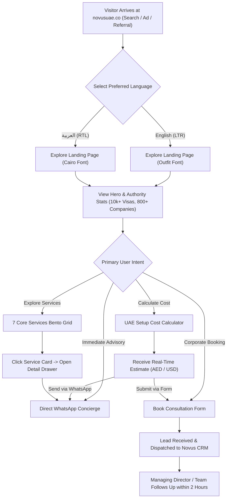
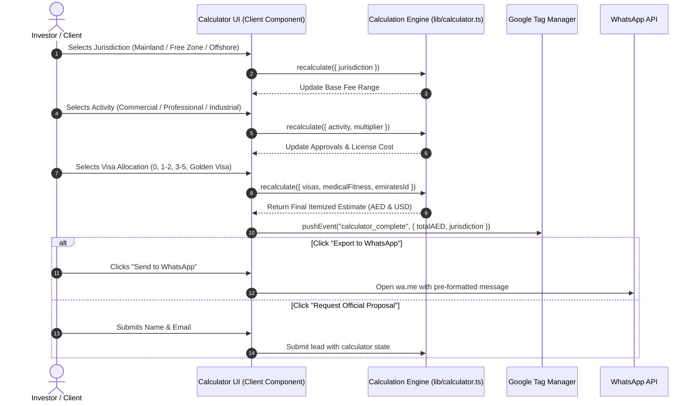
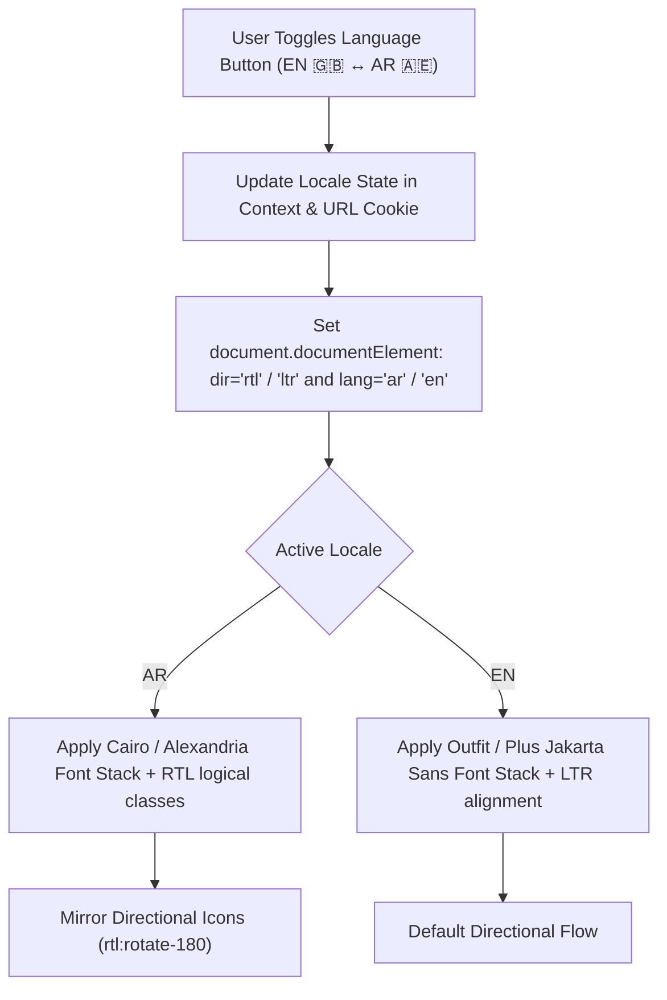

# 🔄 Novus UAE — User & Data Flow Architecture (USER_DATA_FLOW.md)

This document diagrams the user journeys, data pipelines, state transitions, and third-party integrations across the Novus digital platform.

---

## 1. Investor Lead & Acquisition Journey



---

## 2. Interactive UAE Setup Cost Calculator Data Flow



---

## 3. Lead Capture & Security Pipeline Flow

```mermaid
flowchart LR
    subgraph ClientBrowser [Client Browser]
        Form["Consultation Form"]
        ZodClient["Client Zod Validation"]
        HoneypotField["Hidden Honeypot Field"]
        TimestampCheck["Submission Timing Metric"]
    end

    subgraph EdgeServer [Next.js Edge / Server Action]
        RateLimiter["Rate Limiter (Max 5/min)"]
        HoneypotCheck{"Honeypot Filled?"}
        TimeCheck{"Time < 2s?"}
        ZodServer["Server-side Zod Schema"]
    end

    subgraph NotificationPipe [Notification & Telemetry]
        EmailService["Resend / SMTP Mailer"]
        GTMEvent["GTM dataLayer Event"]
        ClientAlert["Executive Team Notification"]
    end

    Form --> ZodClient
    ZodClient -->|Valid| EdgeServer
    HoneypotField --> HoneypotCheck
    TimestampCheck --> TimeCheck

    EdgeServer --> RateLimiter
    RateLimiter -->|Pass| HoneypotCheck
    HoneypotCheck -->|Empty (Legitimate)| TimeCheck
    HoneypotCheck -->|Filled (Bot)| RejectBot["Silently Drop / Reject 400"]
    TimeCheck -->|Legitimate Human| ZodServer
    TimeCheck -->|Instant (Bot)| RejectBot

    ZodServer -->|Sanitized Payload| NotificationPipe
    NotificationPipe --> EmailService
    NotificationPipe --> GTMEvent
    NotificationPipe --> ClientAlert
```

---

## 4. Bilingual Engine & Dynamic Layout Switch Flow


